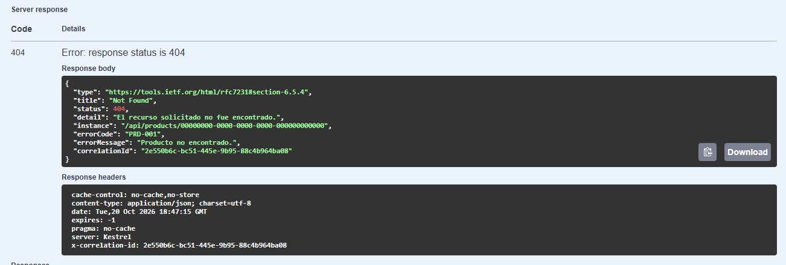
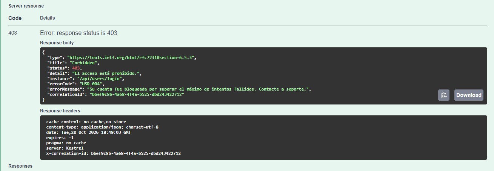
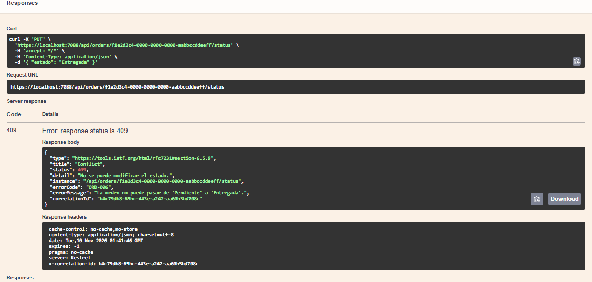
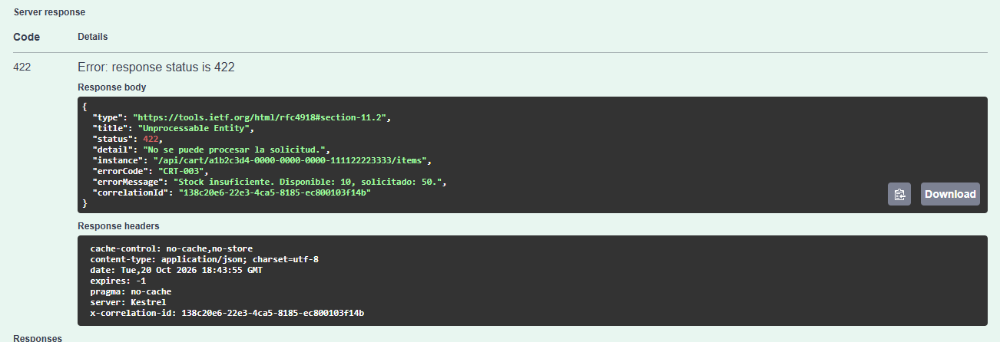
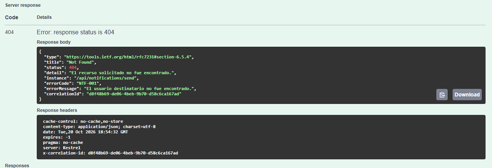

# cai-tp-ecommerce

Trabajo Práctico de CAI: **E-Commerce con arquitectura de microservicios** en C# / .NET 10.

El sistema está formado por **5 microservicios independientes**, cada uno una REST API con su propia documentación en Swagger:

| Servicio | Responsabilidad | Responsable |
|---|---|---|
| **Products.API** | Catálogo de productos: alta, baja, modificación y consulta (con filtros por categoría y nombre). | Manu |
| **Users.API** | Registro y login de usuarios. Bloqueo por intentos fallidos. | Rodri |
| **Orders.API** | Creación de órdenes y cambios de estado. Valida usuario, productos y stock. | Valen |
| **Cart.API** | Carrito de compras de cada usuario: agregar, modificar, quitar y vaciar. | Rodri |
| **Notifications.API** | Registro y envío simulado de notificaciones (Email, Push, SMS). | Manu |

---

## Arquitectura

```
                   Cliente (Swagger UI / archivos .http)
                                    │
                                    │  HTTP + JSON
     ┌──────────────┬───────────────┼───────────────┬───────────────────┐
     ▼              ▼               ▼               ▼                   ▼
Products.API    Users.API      Orders.API       Cart.API      Notifications.API
   :7172          :7198          :7088            :7017             :7223


Llamadas internas entre servicios:

   Orders.API ─────────► Users.API       ¿existe el usuario?
   Orders.API ─────────► Products.API    ¿existen los productos? ¿hay stock?
   Cart.API ───────────► Products.API    ¿existe el producto? ¿hay stock?
   Notifications.API ──► Users.API       ¿existe el destinatario?
   Products.API ───────► Orders.API      ¿el producto tiene órdenes activas?
```

**Llamadas entre servicios** (HTTP, con `IHttpClientFactory`):

| Origen | Destino | Para qué | Error si falla |
|---|---|---|---|
| Orders | Users | Validar que el usuario exista al crear una orden | ORD-003 |
| Orders | Products | Validar productos, stock y capturar el precio | ORD-004 / ORD-005 |
| Cart | Products | Validar que el producto exista y que haya stock | CRT-002 / CRT-003 |
| Notifications | Users | Validar que el destinatario exista | NTF-001 |
| Products | Orders | Ver si el producto tiene órdenes activas antes de borrarlo | PRD-004 |

Cada servicio tiene su propia carpeta y sus propias clases. No comparten código.

---

## Estructura del repositorio

```
cai-tp-ecommerce/
├── ECommerce.sln            # solución con todos los proyectos
├── README.md
├── docs/                   # reparto y fichas del equipo
└── src/
    ├── Products.API/
    ├── Users.API/
    ├── Orders.API/
    ├── Cart.API/
    └── Notifications.API/
```

Dentro de cada API:

```
<Servicio>.API/
├── Controllers/        # endpoints: reciben el pedido, llaman al service y devuelven la respuesta
├── Services/           # lógica de negocio; lanza las excepciones de dominio
├── Data/               # acceso a la base SQLite (repositorio, inicializador y datos de prueba)
├── DTOs/               # lo que entra (Request) y lo que sale (Response) de cada endpoint
├── Models/             # entidades del dominio
├── Exceptions/         # excepciones de dominio y códigos de error
├── ExceptionHandlers/  # un IExceptionHandler por tipo de excepción
├── Configuracion/      # respuesta 400 de las validaciones (Data Annotations)
├── Swagger/            # configuración de Swagger y ejemplos de error
├── HealthChecks/       # chequeos de salud del servicio
├── Logging/            # middleware de Correlation ID
├── Clients/            # clientes HTTP hacia otros servicios y propagación del Correlation ID
├── logs/               # archivos de log (se generan al ejecutar; no se suben al repo)
└── Program.cs          # configuración (Serilog, Swagger, health checks, etc.)
```

---

## Puertos

| Servicio | HTTP | HTTPS | Swagger |
|---|---|---|---|
| Products.API | 5095 | 7172 | https://localhost:7172/swagger |
| Users.API | 5199 | 7198 | https://localhost:7198/swagger |
| Orders.API | 5298 | 7088 | https://localhost:7088/swagger |
| Cart.API | 5230 | 7017 | https://localhost:7017/swagger |
| Notifications.API | 5147 | 7223 | https://localhost:7223/swagger |

Los puertos están definidos en `src/<Servicio>.API/Properties/launchSettings.json` de cada proyecto.

---

## Cómo ejecutar

### Requisitos
- **Visual Studio 2026** con la carga de trabajo *ASP.NET y desarrollo web* (Visual Studio 2022 no soporta .NET 10).
- **SDK de .NET 10**.

### Levantar un servicio
1. Abrir `ECommerce.sln` con Visual Studio.
2. En el *Solution Explorer*, clic derecho sobre el servicio (por ejemplo `Users.API`) → **Set as Startup Project**.
3. Ejecutar con el perfil **https** (botón verde ▶).
4. La primera vez, aceptar el certificado de desarrollo HTTPS (**Yes**).
5. Abrir en el navegador la URL de Swagger del servicio (ver tabla de puertos). El navegador no se abre solo.

### Levantar varios servicios a la vez
Clic derecho sobre la solución → **Configure Startup Projects…** → **Multiple startup projects** → poner en **Start** los servicios que se quieran levantar.

Algunos endpoints consultan a otros servicios, así que para probarlos tienen que estar corriendo:

| Para probar | Hay que levantar |
|---|---|
| Carrito (`POST` y `PUT` de productos) | Cart.API y Products.API |
| Crear una orden | Orders.API, Users.API y Products.API |
| Enviar una notificación | Notifications.API y Users.API |
| Eliminar un producto | Products.API y Orders.API |
| Todo lo demás | Solo el servicio que se prueba |

Si el servicio consultado está apagado, el pedido responde **500** con el código de error genérico del servicio (por ejemplo, `ORD-007`): una falla del otro servicio no se confunde con "no encontrado".

### Probar sin Swagger
Cada proyecto tiene un archivo `<Servicio>.API.http` con pedidos de ejemplo. Se abre en Visual Studio y se usa el link **Send request** que aparece arriba de cada pedido.

---

## Documentación de las APIs (Swagger)

- Cada servicio expone **Swagger UI en `/swagger`** (con Swashbuckle.AspNetCore).
- Cada endpoint está documentado con comentarios XML (`///`): descripción, parámetros, body y **todos los códigos de respuesta** con su `errorCode`.
- Los DTOs tienen **ejemplos** con los mismos valores que los ejemplos del enunciado.
- Los endpoints se agrupan por servicio (tag).

---

## Health checks

Cada servicio expone tres endpoints de salud. Responden en JSON con el estado `Healthy`, `Degraded` o `Unhealthy`.

| Endpoint | Para qué sirve |
|---|---|
| `GET /health` | Estado general del servicio (todos los chequeos, incluidos los de dependencias). |
| `GET /health/ready` | ¿Está **listo**? Chequea el propio servicio y los servicios de los que depende. |
| `GET /health/live` | ¿Está **vivo**? Solo verifica que el proceso responda; no mira a otros servicios. |

Ejemplo de respuesta (`https://localhost:7172/health`):

```json
{
  "status": "Healthy",
  "servicio": "Products.API",
  "checks": {
    "api": "Healthy",
    "orders": "Healthy"
  }
}
```

### Dependencias en `/health/ready`

`/health/ready` no solo mira al propio servicio: también pregunta (con `GET /health/live`) a los servicios de los que depende. Si alguno no responde, el estado pasa a **Degraded** (el servicio sigue vivo, pero con funciones limitadas). El código HTTP es 200 para `Healthy` y `Degraded`, y 503 para `Unhealthy`.

| Servicio | Depende de | Si no responde |
|---|---|---|
| Products.API | Orders.API | `Degraded` |
| Cart.API | Products.API | `Degraded` |
| Orders.API | Users.API y Products.API | `Degraded` |
| Notifications.API | Users.API | `Degraded` |

Users.API no llama a otros servicios: su `/health/ready` solo agrega el chequeo de su propia base.

Los 5 servicios, además, chequean su propia base de datos SQLite (check `sqlite`). Si no pueden abrirla, el estado es `Unhealthy` (HTTP 503), porque sin base el servicio no puede trabajar. Las URLs de los servicios destino se configuran en `appsettings.json` (sección `Servicios`).

Ejemplo de `https://localhost:7172/health/ready` con Orders.API apagado:

```json
{
  "status": "Degraded",
  "servicio": "Products.API",
  "checks": {
    "api": "Healthy",
    "orders": "Degraded",
    "sqlite": "Healthy"
  }
}
```

---

## Logs y Correlation ID

Los logs se generan con **Serilog** en dos lugares:

| Destino | Formato | Dónde |
|---|---|---|
| **Consola** | Legible: `[hora NIVEL] [Servicio] [CorrelationId] mensaje` | La ventana que se abre al ejecutar el servicio. |
| **Archivo** | JSON estructurado, un archivo por día | `src/<Servicio>.API/logs/<servicio>-AAAAMMDD.json` (por ejemplo `logs/products-20261015.json`). |

Cada log incluye fecha y hora, nivel, servicio, endpoint y Correlation ID. Se registra el inicio y el fin de cada request, con su duración.

**Errores:** cuando el log corresponde a un error, incluye también el `ErrorCode` del catálogo. Los errores de negocio y de validación (400, 401, 403, 404, 409, 422) se registran con nivel **Warning**, y los errores inesperados (500) con nivel **Error**, junto con el detalle técnico de la excepción. Ejemplo de una línea del archivo JSON:

```json
{"Timestamp":"2026-10-20T16:26:46.1544605-03:00","Level":"Warning","RenderedMessage":"Recurso no encontrado. ErrorCode \"PRD-001\": \"Producto no encontrado.\"","Properties":{"ErrorCode":"PRD-001","Endpoint":"GET /api/products/00000000-0000-0000-0000-000000000000","CorrelationId":"f8409c31-2873-4be5-b361-0adfb9c9a693","Servicio":"Products.API"}}
```

**Correlation ID:** cada request tiene un identificador único que permite seguirla en los logs.

- Si el pedido trae el header **`X-Correlation-Id`**, se usa ese valor. Si no, el servicio genera uno nuevo.
- El servicio lo devuelve en el header **`X-Correlation-Id`** de la respuesta (se puede ver en Swagger, en *Response headers*).
- Todos los logs de esa request llevan el mismo Correlation ID.
- Las respuestas de error también lo incluyen, en el campo `correlationId`.
- Cuando un servicio llama a otro, **propaga el mismo Correlation ID** en el header de la llamada saliente (un `CorrelationIdHandler` lo agrega a cada llamada del `HttpClient`). Así una misma operación se puede seguir en los logs de varios servicios.

Para probarlo, los archivos `.http` de los 5 servicios tienen un pedido a `/health` que manda un Correlation ID propio. Para ver la propagación entre servicios, levantar dos a la vez (por ejemplo Notifications y Users), mandar `GET /health/ready` a Notifications con un `X-Correlation-Id` propio y buscar ese mismo ID en el log de Users (`Inicio de request GET /health/live`). También se ve en Swagger, en los *Response headers* de cualquier respuesta.

---

## Formato de las respuestas de error

Todas las respuestas de error (4xx y 5xx) siguen el formato *Problem Details*, con dos campos propios obligatorios: `errorCode` y `errorMessage`. Además incluyen `correlationId`, para poder buscar la request en los logs.

```json
{
  "type": "https://tools.ietf.org/html/rfc7231#section-6.5.4",
  "title": "Not Found",
  "status": 404,
  "detail": "El recurso solicitado no fue encontrado.",
  "instance": "/api/products/99",
  "errorCode": "PRD-001",
  "errorMessage": "Producto no encontrado.",
  "correlationId": "2e550b6c-bc51-445e-9b95-88c4b964ba08"
}
```
---

## Códigos de error

### Products.API
| errorCode | HTTP | errorMessage | Cuándo se devuelve |
|---|---|---|---|
| PRD-001 | 404 | Producto no encontrado. | GET/PUT/DELETE cuando el ID no existe. |
| PRD-002 | 400 | Los datos del producto son inválidos. | POST/PUT con campos faltantes o formato incorrecto. |
| PRD-003 | 409 | Ya existe un producto con ese nombre en la categoría. | POST cuando se intenta crear un duplicado. |
| PRD-004 | 409 | El producto tiene órdenes activas y no puede eliminarse. | DELETE cuando hay órdenes Pendiente o Confirmada que lo referencian. |
| PRD-005 | 500 | Error interno al procesar el producto. | Error inesperado en servicio o persistencia. |

### Users.API
| errorCode | HTTP | errorMessage | Cuándo se devuelve |
|---|---|---|---|
| USR-001 | 409 | El email ya está registrado. | POST /register cuando el email ya existe. |
| USR-002 | 400 | Los datos del usuario son inválidos. | POST /register con campos faltantes o formato incorrecto. |
| USR-003 | 401 | Credenciales incorrectas. | POST /login cuando email o contraseña no coinciden. |
| USR-004 | 403 | Usuario bloqueado por demasiados intentos fallidos. | POST /login con 3 o más intentos fallidos acumulados. |
| USR-005 | 403 | Usuario bloqueado por detección de fraude. | POST /login cuando el usuario fue bloqueado manualmente. |
| USR-006 | 500 | Error interno al procesar el usuario. | Error inesperado en servicio o persistencia. |

### Orders.API
| errorCode | HTTP | errorMessage | Cuándo se devuelve |
|---|---|---|---|
| ORD-001 | 404 | Orden no encontrada. | GET/PUT cuando el ID de orden no existe. |
| ORD-002 | 400 | Los datos de la orden son inválidos. | POST con campos faltantes o lista de items vacía. |
| ORD-003 | 404 | Usuario no encontrado al crear la orden. | POST cuando el UsuarioId no existe en Users API. |
| ORD-004 | 404 | Producto no encontrado al crear la orden. | POST cuando algún ProductoId no existe en Products API. |
| ORD-005 | 422 | Stock insuficiente para uno o más productos. | POST cuando la cantidad solicitada supera el stock disponible. |
| ORD-006 | 409 | El estado de la orden no puede ser modificado. | PUT /status cuando la transición de estado no es válida. |
| ORD-007 | 500 | Error interno al procesar la orden. | Error inesperado en servicio o persistencia. |

### Cart.API
| errorCode | HTTP | errorMessage | Cuándo se devuelve |
|---|---|---|---|
| CRT-001 | 404 | Carrito no encontrado. | GET/PUT/DELETE cuando el userId no tiene carrito activo. |
| CRT-002 | 404 | Producto no encontrado. | POST/PUT cuando el ProductoId no existe en Products API. |
| CRT-003 | 422 | Stock insuficiente para agregar al carrito. | POST/PUT cuando la cantidad supera el stock disponible. |
| CRT-004 | 400 | Cantidad inválida. | POST/PUT cuando la cantidad es menor o igual a cero. |
| CRT-005 | 500 | Error interno al procesar el carrito. | Error inesperado en servicio o persistencia. |

### Notifications.API
| errorCode | HTTP | errorMessage | Cuándo se devuelve |
|---|---|---|---|
| NTF-001 | 404 | Usuario no encontrado. | POST cuando el UsuarioId no existe en Users API. |
| NTF-002 | 400 | Los datos de la notificación son inválidos. | POST con campos faltantes o tipo no reconocido. |
| NTF-003 | 404 | No se encontraron notificaciones para el usuario. | GET cuando el userId no tiene notificaciones registradas. |
| NTF-004 | 500 | Error interno al procesar la notificación. | Error inesperado en servicio o persistencia. |

---

## Decisiones y supuestos

Decisiones tomadas por el equipo donde el enunciado no define algo, o lo deja abierto.

| Fecha | Decisión | Motivo |
|---|---|---|
| 07/10/2026 | Se usan **controladores** (no Minimal API). | El enunciado pide la carpeta `Controllers/` y comentarios XML en controladores. |
| 07/10/2026 | Los IDs son **Guid**. El JSON usa nombres en **español y camelCase**. | Así aparecen en los ejemplos del enunciado. |
| 11/10/2026 | Las colecciones (`Items` de Cart y Order) son **`List<T>`** en vez de arrays. | A carritos y órdenes se les agregan y quitan elementos. |
| 11/10/2026 | Los endpoints **devuelven DTOs**, nunca los modelos directamente. | Controlar qué datos salen; por ejemplo, `PasswordHash` nunca aparece en una respuesta. |
| 06/11/2026 | La persistencia usa **SQLite + Dapper**, con **una base por servicio** (`products.db`, `users.db`, etc.). Se configura en `appsettings.json` (`ConnectionStrings:DefaultConnection`). Las tablas se crean solas al arrancar y se cargan datos de prueba con los IDs del enunciado. | Seguimos el patrón del ejemplo ToDoList de la cátedra; cada servicio es dueño de sus datos, como pide una arquitectura de microservicios. |
| 06/11/2026 | Los archivos `*.db` **no se suben al repositorio** (están en `.gitignore`). | Son datos locales de prueba; se regeneran solos al ejecutar el servicio. |
| 06/11/2026 | En SQLite los **Guid y las fechas se guardan como texto** (fechas en ISO 8601, UTC). Un `TypeHandler` de Dapper los convierte al leer. | SQLite no tiene tipos Guid ni fecha; así las fechas siguen saliendo en UTC con "Z", como en los ejemplos del enunciado. |
| 11/10/2026 | Swagger con **Swashbuckle.AspNetCore 10.3.0**, habilitado en el entorno Development. Se configura en una clase propia (`Swagger/ConfiguracionSwagger.cs`). | Es la librería que pide el enunciado. |
| 06/11/2026 | El código **no usa lambdas, LINQ, `Dictionary`/`HashSet` ni `Sort`/`OrderBy` nativos**. Se usan `foreach`, `List<T>` y métodos con nombre; el orden se hace en SQL con `ORDER BY`. La configuración que suele usar lambdas también está en clases (`ConfiguracionApi`, `ConfiguracionSwagger`). | Son las mismas restricciones de la guía de ejercicios, y así todo el equipo puede explicar cada parte del código en la defensa. |
| 11/10/2026 | `POST /api/users/login` con datos inválidos (400) → **USR-002**. | El enunciado lista el 400 pero no le asigna un código. Se reutiliza el de "datos inválidos" del mismo servicio. |
| 11/10/2026 | `DELETE /api/cart/{userId}/items/{productId}` cuando falla (404) → **CRT-001**. | El enunciado no asigna un código para quitar un producto que no está en el carrito. |
| 15/10/2026 | `PUT /api/orders/{id}/status` con datos inválidos (400) → **ORD-002**. | El enunciado lista ese código HTTP pero no le asigna un `errorCode`. |
| 19/10/2026 | `POST /api/orders` no documenta un 409. | El enunciado lo lista, pero ningún `errorCode` del catálogo corresponde a ese caso. |
| 19/10/2026 | En Cart, cualquier 400 automático (datos mal formados) usa **CRT-004**. | Es el único código 400 del catálogo de Cart. |
| 19/10/2026 | Mientras un servicio no tenga lógica real, sus endpoints **tiran errores con datos de prueba** (ver tabla "Cómo probar los errores"). | Poder probar y mostrar en Swagger cada código de error antes de tener persistencia. |
| 20/10/2026 | `/health/ready` chequea los servicios de los que depende y devuelve `Degraded` (HTTP 200) si no responden. `/health/live` no depende de nadie. | Distinguir "el proceso está vivo" de "puede trabajar con normalidad". |
| 20/10/2026 | Las llamadas entre servicios usan clientes HTTP tipados (`IHttpClientFactory`) y un `CorrelationIdHandler` que propaga el Correlation ID. | El enunciado pide propagarlo en las llamadas HTTP salientes. |
| 20/10/2026 | Los errores de negocio se registran como Warning y los inesperados como Error, siempre con su `ErrorCode`. | Lo pide el enunciado (5.3). |
| 06/11/2026 | Para las consultas entre servicios se usan **endpoints internos ocultos de Swagger** (`[ApiExplorerSettings(IgnoreApi = true)]`): `GET /api/users/{id}` en Users (lo usan Orders y Notifications) y `GET /api/orders/internal/by-product/{productoId}` en Orders (lo usa Products para PRD-004). | El enunciado no define cómo se consultan entre sí; así no se agregan endpoints "públicos" que no están en el contrato. |
| 06/11/2026 | Si otro servicio falla (caído, timeout o error 500), **no se lo convierte en "no encontrado"**: el error termina en un 500 del manejador global. Solo un 404 del otro servicio se traduce al error de dominio correspondiente. | Distinguir "el dato no existe" de "no pude consultarlo". |
| 06/11/2026 | **Crear una orden no descuenta stock.** | El enunciado no lo pide. |
| 06/11/2026 | Las órdenes avanzan `Pendiente → Confirmada → Enviada → Entregada`. Se puede pasar a `Cancelada` solo desde `Pendiente` o `Confirmada`; cualquier otro cambio devuelve **ORD-006**. Un estado desconocido devuelve **ORD-002**. | El enunciado define los estados pero no las transiciones. |
| 06/11/2026 | Login de Users: usuario inactivo con 3 o más intentos fallidos → **USR-004** (bloqueado); inactivo con menos de 3 → **USR-005** (desactivado). | Distinguir las dos causas con los códigos del catálogo. |
| 06/11/2026 | El carrito se crea al agregar el primer producto. `GET` de un carrito que no existe devuelve **CRT-001**. | El enunciado no dice cuándo se crea. |
| 06/11/2026 | Un usuario sin notificaciones recibe **NTF-003** (404) al listarlas. | Es el código del catálogo para ese caso. |

### Consultas con la cátedra (resueltas)
- **Librería de persistencia:** no es una librería aparte. Se sigue el patrón del ejemplo ToDoList de la cátedra (SQLite + Dapper).
- **Formato de la solución:** se usa `ECommerce.sln`, como pide el enunciado.
- **Lambdas, LINQ y `Dictionary`:** el equipo decidió no usarlos (ver la tabla de decisiones).

---

## Cómo probar los errores

Los 5 servicios tienen lógica real y guardan sus datos en su propia base SQLite, así que cada error se provoca con datos reales (ver las filas de abajo). Los datos de prueba (los IDs del enunciado) se crean solos la primera vez que arranca cada servicio; si se quiere volver al estado inicial, alcanza con apagar el servicio y borrar su archivo `.db`.

Datos de prueba que usan varias filas: la Notebook (`3fa85f64-5717-4562-b3fc-2c963f66afa6`, stock 10), la Silla (`aaaabbbb-cccc-dddd-eeee-ffff00001111`, stock 8) y la orden de María (`f1e2d3c4-0000-0000-0000-aabbccddeeff`, estado Pendiente, con 2 Notebooks).

| Servicio | Pedido | Dato de prueba | Respuesta |
|---|---|---|---|
| Products | `GET`, `PUT` o `DELETE /api/products/{id}` | `id` = `00000000-0000-0000-0000-000000000000` | 404 · PRD-001 |
| Products | `POST /api/products` | un `nombre` y una `categoria` que ya existen (por ejemplo `Notebook Dell XPS 15` en `Electrónica`) | 409 · PRD-003 |
| Products | `DELETE /api/products/{id}` | un producto con órdenes en estado Pendiente o Confirmada | 409 · PRD-004 (por ejemplo la Notebook, que está en la orden de María; hay que tener Orders.API corriendo) |
| Products | `POST` o `PUT` | precio 0, nombre vacío, etc. | 400 · PRD-002 |
| Products | `GET /api/products/{id}` | `id` = `ffffffff-ffff-ffff-ffff-ffffffffffff` | 500 · PRD-005 (falla simulada) |
| Users | `POST /api/users/register` | `email` = `maria@email.com` (ya existe en los datos de prueba) | 409 · USR-001 |
| Users | `POST /api/users/login` | contraseña incorrecta (3 seguidas bloquean al usuario → el siguiente intento da USR-004) | 401 · USR-003 |
| Users | `POST /api/users/login` | `email` = `bloqueado@email.com` | 403 · USR-004 |
| Users | `POST /api/users/login` | `email` = `fraude@email.com` | 403 · USR-005 |
| Users | `register` o `login` | email mal formado o campos vacíos | 400 · USR-002 |
| Users | `POST /api/users/register` | `email` = `falla@email.com` | 500 · USR-006 (falla simulada) |
| Orders | `GET` o `PUT /api/orders/{id}...` | `id` = todo ceros | 404 · ORD-001 |
| Orders | `POST /api/orders` | `items` vacío | 400 · ORD-002 |
| Orders | `POST /api/orders` | `usuarioId` de un usuario que no existe, por ejemplo todo ceros (con Users.API corriendo) | 404 · ORD-003 |
| Orders | `POST /api/orders` | algún `productoId` que no existe, por ejemplo todo ceros (con Products.API corriendo) | 404 · ORD-004 |
| Orders | `POST /api/orders` | una `cantidad` mayor al stock (por ejemplo 11 Notebooks, que tienen stock 10) | 422 · ORD-005 |
| Orders | `PUT /api/orders/{id}/status` | `estado` = `Entregada` sobre una orden Pendiente (la transición no está permitida) | 409 · ORD-006 |
| Orders | `PUT /api/orders/{id}/status` | `estado` que no existe, por ejemplo `Volando` | 400 · ORD-002 |
| Orders | `GET /api/orders/{id}` | `id` = `ffffffff-ffff-ffff-ffff-ffffffffffff` | 500 · ORD-007 (falla simulada) |
| Cart | `GET`, `PUT` o `DELETE /api/cart/{userId}...` | `userId` = todo ceros | 404 · CRT-001 |
| Cart | `POST` o `PUT .../items` | un `productoId` que no existe, por ejemplo todo ceros (con Products.API corriendo) | 404 · CRT-002 |
| Cart | `POST` o `PUT .../items` | una `cantidad` mayor al stock (por ejemplo 11 Notebooks, que tienen stock 10; en el `POST` se cuenta también lo que ya hay en el carrito) | 422 · CRT-003 |
| Cart | `POST` o `PUT .../items` | `cantidad` 0 o negativa | 400 · CRT-004 |
| Cart | `GET /api/cart/{userId}` | `userId` = `ffffffff-ffff-ffff-ffff-ffffffffffff` | 500 · CRT-005 (falla simulada) |
| Notifications | `POST /api/notifications/send` | `usuarioId` de un usuario que no existe, por ejemplo todo ceros (con Users.API corriendo) | 404 · NTF-001 |
| Notifications | `POST /api/notifications/send` | `tipo` distinto de Email, Push o SMS | 400 · NTF-002 |
| Notifications | `GET /api/notifications/{userId}` | un `userId` sin notificaciones, por ejemplo todo ceros | 404 · NTF-003 |
| Notifications | `GET /api/notifications/{userId}` | `userId` = `ffffffff-ffff-ffff-ffff-ffffffffffff` | 500 · NTF-004 (falla simulada) |

Si Users.API está apagado, `POST /api/notifications/send` responde **500 · NTF-004**: una falla de otro servicio no se confunde con "usuario no encontrado".

Para ver el 500, Products, Notifications, Users, Cart y Orders tienen un dato de prueba que lanza una falla simulada (ver las filas "falla simulada" de la tabla). El `GlobalExceptionHandler` la convierte en el código 500 de cada servicio (PRD-005, NTF-004, USR-006, CRT-005, ORD-007) y la registra en el log con nivel Error.

---

## Capturas de Swagger

Ejemplos de respuestas de error en Swagger UI, con `errorCode`, `errorMessage` y `correlationId`.

### Products · 404 PRD-001


### Users · 403 USR-004


### Orders · 409 ORD-006


### Cart · 422 CRT-003


### Notifications · 404 NTF-001

